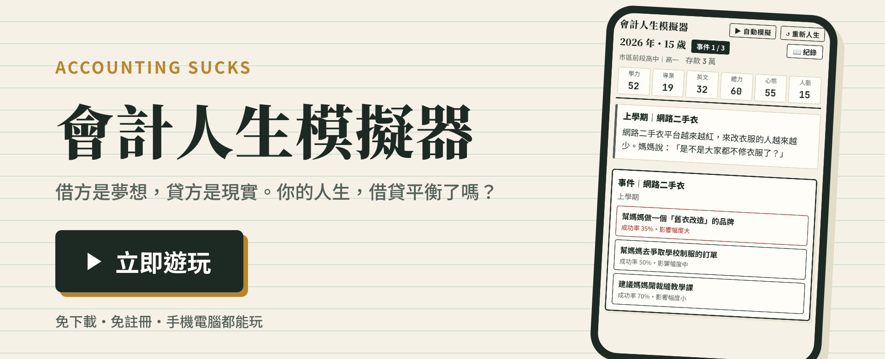
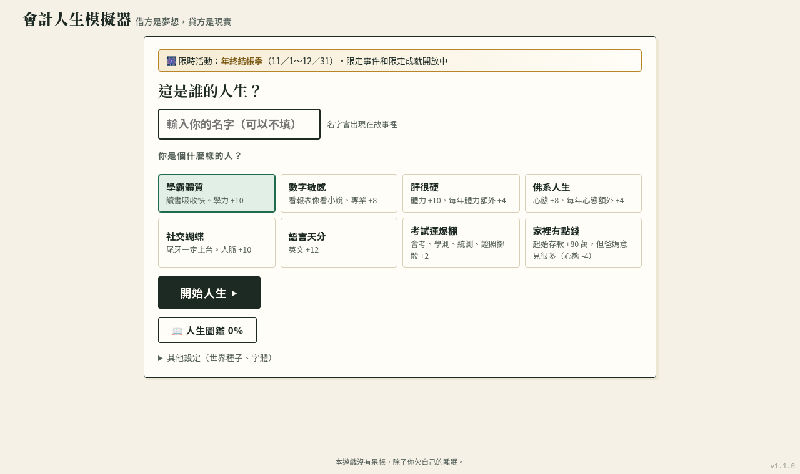
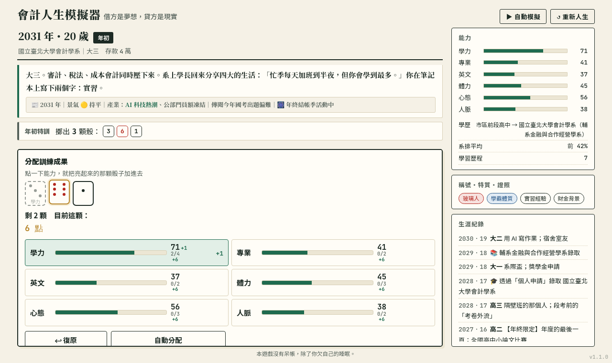
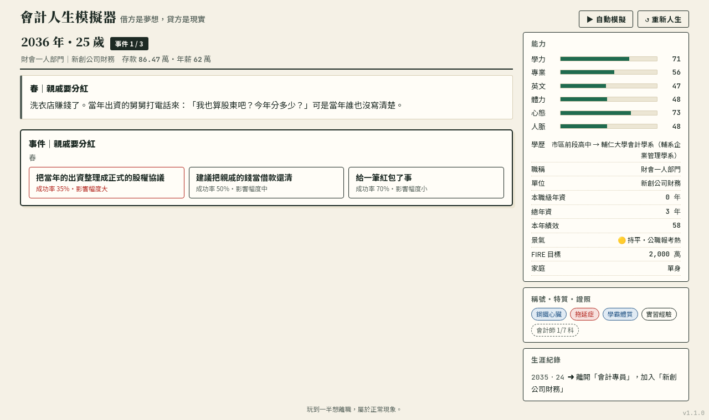
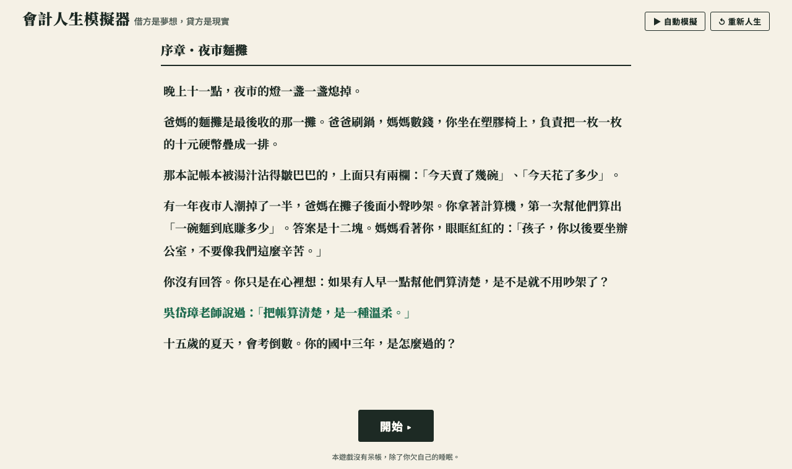
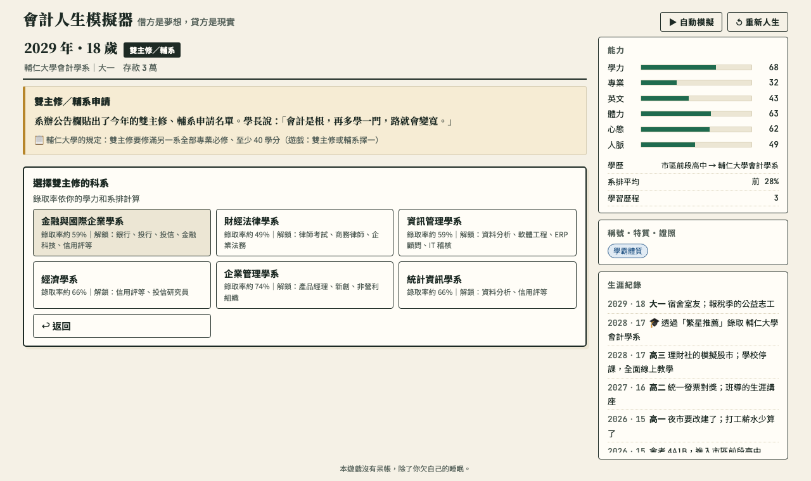
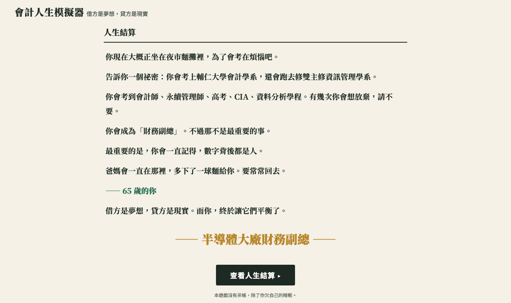
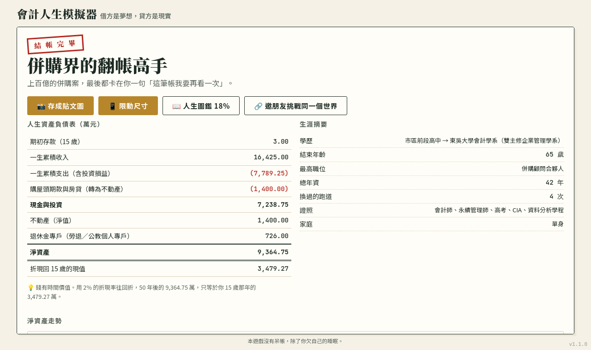
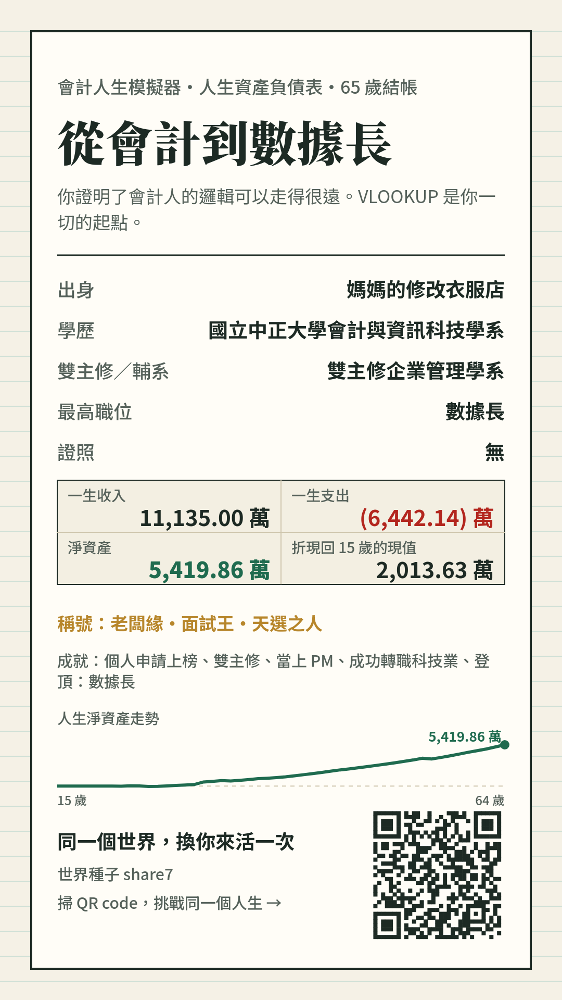
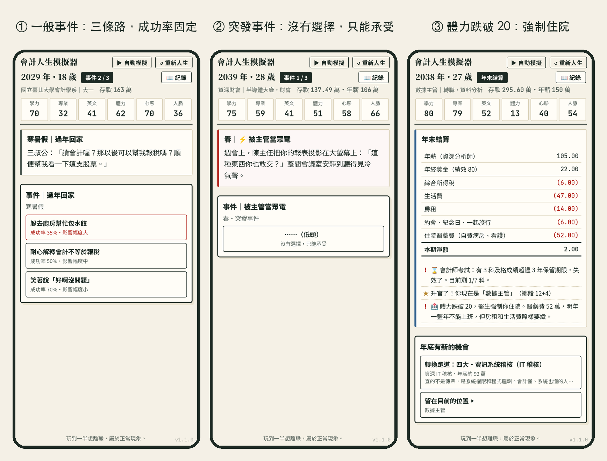

# 會計人生模擬器

<b>👆 點圖馬上玩</b>　免下載・免註冊・手機電腦都行・主管看不出來（大概）

---

> <b>借方是夢想，貸方是現實。</b>
>
> 你十五歲，家裡開了一間小店，櫃檯下壓著一本記了很多年的帳。
> 那時候的你還不知道，這輩子會跟「借」和「貸」糾纏到退休。

從國三會考一路活到 65 歲。
你會考試、落榜、再考、進四大、爆肝、住院、被倒帳、被查帳，偶爾也會中發票。

<b>一局 15～30 分鐘。比會計師考試短很多，痛苦程度大概只有它的十分之一。</b>

👆 點下去，換你來活。

---

## 🎮 怎麼玩？三句話講完

1. <b>每年擲骰。</b> 把骰子分給學力、專業、英文、體力、心態、人脈。全押學力衝會考？還是留一點給體力，免得高三就倒下？
2. <b>每年選兩件事做。</b> 念書、補習、談戀愛、打電動耍廢……出社會後還有「埋頭苦幹」「經營人脈」，以及每個上班族都想選的「安靜離職」。
3. <b>每年遇到三個事件。</b> 每個都有高、中、低三種風險，成功率固定是 35%／50%／70%，<b>沒有一條保證成功</b>。

擲出 20 是大成功，擲出 1 是大失敗。運氣好會覺醒「考神」「天選之人」，運氣不好會得到「衰神附體」。人生嘛。

---

## 🎯 先試玩一題：你會怎麼選？

> <b>🏠 房東要賣房子了</b>
>
> 房東傳 LINE：「不好意思，房子要賣了，麻煩下個月底前搬走喔。」後面附了一個微笑貼圖。

<b>點一個選項，看看你的命運 👇</b>

🔴 <b>翻出租約，跟房東談搬遷補償</b>　高風險・成功率 35%

 

| 🎲 擲骰 | 結果 |
|---|---|
| <b>成功</b> | 你指出租約的提前解約條款，房東最後補貼了一個月租金和搬家費。 `專業 +3`　`存款 +5 萬` |
| <b>失敗</b> | 房東說：「不爽可以去告啊。」你算了一下訴訟成本，默默開始打包。 `心態 −3`　`存款 −8 萬` |

⚫ <b>請朋友幫忙找房、搬家</b>　中風險・成功率 50%

 

| 🎲 擲骰 | 結果 |
|---|---|
| <b>成功</b> | Kevin 開車幫你搬了三趟，你請大家吃了一頓燒肉。 `人脈 +2`　`存款 −4 萬` |
| <b>失敗</b> | 新房子租金貴了三成，坪數還少了一半。 `心態 −2`　`存款 −10 萬` |

⚪ <b>隨便找一間先住</b>　低風險・成功率 70%

 

| 🎲 擲骰 | 結果 |
|---|---|
| <b>成功</b> | 新房間沒有窗戶，但至少離捷運站近。 `存款 −4 萬` |
| <b>失敗</b> | 搬進去才發現，樓上每天半夜在練鼓。 `心態 −1`　`體力 −1` |

 

選好了嗎？很好。<b>因為人生不會每次都讓你選。</b>

⚡ <b>突發事件：空降部隊</b>（點開，如果你承受得住）

 

> 你等了三年的位子，今天公布了。上面寫的不是你的名字，是老闆的姪子。

只有一個按鈕：

> <b>［ 鼓掌 ］</b>
> 沒有選擇，只能承受

新主管第一天就問你：「這個系統怎麼登入？」

`心態 −15`　`績效 −10`

---

## 🏠 你家那間小店，會跟著你一輩子

每一局隨機出生在 12 種家庭：媽媽的早餐店、爸爸的五金行、阿嬤的柑仔店、爸媽的夜市麵攤、阿公的豆花店……

某一年，店會遇到難關。你當時的選擇，會在十幾年後回來找你：可能是超商採購的一通電話，也可能是一個哄抬租金的二房東。

<b>而且不只家裡的店會記仇。</b> 當年幫朋友當保證人、為了客戶「方便一下」改了一個數字、拒絕了一個紅包……很多年以後，它們都會用你想不到的方式回來。

---

## 😵 會計人才懂的痛，這裡都有

- <b>會計師 7 科</b>（國文＋專業 6 科）可以一科一科累積，但及格的科目只保留 3 年。過期就要重考，然後在某個深夜懷疑人生。
- <b>調查局特考</b>要過筆試、體能、口試。對，會計人也要跑步。
- <b>律師考試</b>要先修法律學分。看得懂財報又看得懂合約，在併購案裡超搶手。
- 大一、大二可以申請<b>雙主修或輔系</b>，各校規定都不一樣。臺大要班排前 20%，政大可以一雙二輔。
- 已經是會計師的人，<b>不會再去考記帳士</b>。我們尊重你的時間。

出社會後，有 <b>36 種跟會計有關的工作</b>等著你：

> 四大審計、四大稅務、併購顧問、IT 稽核、半導體財會、外商 FP&A、新創 CFO、IPO 承銷、創投、國稅局、調查局、金管會檢查員、證交所上市審查、商務律師、ESG 顧問、財會 YouTuber、補教名師……
>
> 還有，四十歲那年辭職去開咖啡廳。

每種工作都有專屬事件：除夕前一天的存貨盤點、ERP 上線前一晚差了 860 萬、藏在附註裡的或有負債、忙季第四十七天的便當……

---

## 🩸 拿命換錢，是會計人的日常

這個遊戲很寫實，寫實到有點厭世。

- <b>體力會慢慢被時間吃掉。</b> 45 歲以後，體力上限每年往下掉，再怎麼休息都補不回來。
- <b>體力跌破 20，醫生會強制你住院。</b> 醫藥費幾十萬，隔年整年不能上班、沒有薪水，但房租、生活費照樣要繳。出院回到公司，位子可能已經有人坐了。
- <b>體力跌破 10，你會倒在辦公桌前。</b> 同事以為你只是又趴著睡著了。
- <b>壞事不會先問你。</b> 被主管當眾電、背黑鍋、空降部隊搶走你等了三年的位子、同期五個升了四個、年終縮水、突然被資遣、研究所又落榜……這些事沒有選項，你只能承受。
- <b>錢比你想像中難存。</b> 房租、車貸、約會、孝親費、小孩、房貸、爸媽的長照……每到年底，你都會打開帳本嘆一口氣。

> 不是每一局都這麼慘。但如果你玩到一半覺得很累，那代表遊戲很成功。

---

## 👥 陪你走這一段的人

- <b>Kevin</b>：高中死黨。高二時笑你「以後真的要當會計喔？好無聊欸」，後來卻跑來找你看新創公司的財報。
- <b>吳岱璋老師</b>：國中導師，名字念起來剛好是「無呆帳」。畢業那天送你的一句話，你一輩子都記得。
- <b>你的家人</b>：一直在那間小店裡，用他們的方式疼你。
- <b>你的主管和同事</b>：每份工作都有固定的一位主管、一位同事。罵你的、推鍋給你的，從頭到尾都是同一個人。換工作才換人（但下一個不一定比較好）。

---

## 📊 最後，替你的人生結帳

走到終點，會先播一段人生回顧，再交給你一張<b>人生資產負債表</b>，記到小數第二位（萬元）：

- 一生賺了多少、花了多少（花掉的用紅色括號，會計人都懂）
- 買房的錢不算花掉，而是<b>轉為不動產</b>；房貸的利息才是支出
- 上班族有勞退、公務員有個人專戶，<b>退休金</b>最後也算進淨資產

最後一行，會把你的淨資產<b>折現回 15 歲那年</b>。假設你 65 歲時存到 3,000 萬，用 2% 的折現率往回折 50 年（3,000 ÷ 1.02⁵⁰），只等於 15 歲那年的 <b>1,115 萬</b>。這就是錢的時間價值：同樣一筆錢，越晚拿到，現在的價值越低。

結局有「四大合夥人」「懂會計的併購律師」「年輕的 FIRE 傳說」「帳最漂亮的咖啡廳老闆」……

也有比較厭世的。<b>點開看看，你離哪一個最近？</b>

🏦 幫銀行打工到退休

 退休那天，房貸還沒繳完。你終於懂了：房子是資產，房貸是你的一生。 條件：有買房，但到退休都還在繳房貸。

🏚️ 一輩子幫房東繳房貸

 你算過，這輩子付出去的房租，剛好夠買下當年那間不敢買的房子。 條件：沒買房，退休時淨資產不到 800 萬。

🏥 用健康換存款的人

 你住過好幾次院，病歷比你的履歷還厚。存下來的錢，有一大半最後都繳給了醫院。 條件：體力跌破 20 被強制住院兩次以上。

💔 帳平了，家散了

 財產分得很清楚，每一筆都對得上。只是週末的餐桌，從此只剩一副碗筷。 條件：結過婚、收過離婚協議書。

🕯️ 人生突然關帳

 過勞、意外、突發的疾病。沒有人準備好。 條件：體力跌破 10，或運氣不太好。

### 🔗 丟給朋友，比比看誰活得好

結局可以存成一張圖貼 IG 限動，上面有你的小型資產負債表（一生收入、一生支出、淨資產、現值），限動版還有一條標好金額的淨資產走勢圖。朋友掃了圖上的 QR code，就會出生在<b>跟你一模一樣的世界</b>：同樣的家庭、同樣的景氣、同樣的骰子。

看誰活成四大合夥人，誰活成咖啡廳老闆。

---

## 💡 前輩的忠告

- <b>體力和心態別放著不管。</b> 撐過忙季很帥，撐到住院就不帥了。體力 20 是住院線，10 是人生的停損點。
- <b>英文到 75，新加坡的門就開了。</b> 前提是專業也要有 58。
- <b>高風險只有 35% 會成功，中風險 50%，低風險 70%。</b> 能力再高也一樣，人生就是這樣。解鎖稱號「天選之人」後，會提高到 50%／65%／80%。
- <b>證照是鑰匙。</b> 很多門，沒有那張紙就是進不去。
- <b>存款夠多時，年末會出現「🔥 提早退休」。</b> 你按不按？
- <b>欠錢會越滾越大。</b> 信用卡循環利率從 5% 起跳，欠越久越高，最高 15%。出社會前先記得，這筆帳最後都要自己還。
- <b>會計師要趁年輕考。</b> 年紀越大越難抽出時間準備，而且過了 3 年沒考完的科目會失效。
- <b>右上角的「自動模擬」</b>可以幫你一鍵跑完一生。很適合開會的時候……不，沒事。
- <b>季節限定活動別錯過：</b> 1～3 月四大忙季、5 月報稅季、6～8 月實習季、11～12 月年終結帳季，都有限定事件和成就。
- <b>「📖 人生圖鑑」</b>會記下你遇過的職業、證照、家庭和結局。收集到 100% 的人，請好好休息。

---

## ❓ 常見問題

<b>Q：手機可以玩嗎？</b>
可以。整個遊戲都在一個畫面裡，不用滑。用 Safari 按「分享 → 加入主畫面」，它就會變得像一個 App。

<b>Q：會蒐集我的資料嗎？</b>
不會。遊戲不會把任何東西傳到網路上。名字只出現在故事和分享圖裡，人生圖鑑只存在你自己的瀏覽器。

<b>Q：考試和學校的設定是真的嗎？</b>
大部分照真實制度設計，例如會計師 7 科、各校雙主修規定。為了好玩有些地方做了簡化，真的要報考，請以官方公告為準。

<b>Q：我玩完覺得好累，正常嗎？</b>
正常。這代表遊戲很寫實。

---

<b>🛠️ 給工程師看的</b>

 

- <b>純前端，沒有框架、沒有建置步驟。</b> 原生 HTML／CSS／JavaScript，放在 GitHub Pages 就能跑。
- <b>本機預覽：</b> `python3 -m http.server 8000`，然後打開 http://localhost:8000 。直接雙擊 `index.html` 會被 CSP 擋掉一部分功能。
- <b>同一個種子＋同樣的選擇＝同一段人生。</b> 亂數用 mulberry32 加種子雜湊，分享連結就是靠這個重現同一個世界。
- <b>`index.html` 裡 script 的載入順序很重要</b>，`js/08-auto.js` 一定要放最後。
- <b>安全：</b> 嚴格的 CSP（沒有 `unsafe-inline`），玩家輸入一律經過 `cleanName()`／`cleanSeed()` 過濾，不直接寫進 `innerHTML`。
- <b>平衡測試：</b> `node tools/simulate.js 50`，用自動模擬跑幾百段人生，統計結局、職業分布和死亡率。「錯誤」那一欄要是 0。
- <b>突發事件</b>分兩種：有選項、要擲骰的天災人禍，以及沒有選項、只能承受的職場崩壞（`js/04-sudden.js` 的 `SB()`）。主管和同事的名字依「種子＋工作」固定（`js/05-world.js` 的 `castOf()`）。
- <b>程式碼品質：</b> SonarQube Cloud，Reliability、Security、Maintainability、Security Review 四項評級都是 A。測試覆蓋率由平衡測試量測（設定寫在 `sonar-project.properties`）。

| 想改的東西 | 去哪裡找 |
|---|---|
| 事件 | `js/03*-events-*.js`（`03g-events-fill.js` 幫兩個選項的事件補第三個選項） |
| 突發事件 | `js/04-sudden.js` |
| 職業、考試、每年的行動 | `js/02-jobs.js` |
| 天賦、學校、能力 | `js/01-core.js` |
| 故事、家庭出身 | `js/09-story.js` |
| 畫面 | `js/07-ui.js`、`css/style.css` |
| 結局、成就、分享圖 | `js/06-game.js`、`js/10-extras.js` |

---

## 📜 更新紀錄

<b>v1.1.0</b>　成功率固定、考過的科目會過期

 

<b>🎲 事件</b>
- 成功率固定：高風險 35%、中風險 50%、低風險 70%（「天選之人」50／65／80，「衰神附體」20／35／55）
- 212 個事件補上專屬的第三個選項，不再出現「冷靜應對」「動用所有人脈」
- 修正 21 個事件的風險標示；內容很像的事件，同一段人生只會遇到一個
- 稱號調整：鋼鐵心臟、邊緣人、夜貓子換成真的會生效的效果；社交達人拿掉沒作用的部分

<b>⌛ 證照與升學</b>
- 會計師及格科目保留 3 年、US CPA 保留 30 個月；CIA、CMA 第一次報考起 3 年內要考完
- 會計師變難考了，而且年紀越大越難考，考上的平均年齡約 27 歲，跟考選部的統計差不多
- 難度重新排序：記帳士最簡單，US CPA、CFA 比台灣會計師簡單一級，律師最難（30 歲以後也越來越難考）
- 研究所比大學好考一點點，台大、政大仍然很難
- 報名費照官方金額：會計師 2,300 元、高考 1,800 元、記帳士 2,000 元、律師一試 1,000 元＋二試 2,300 元

<b>💸 錢</b>
- 金額記到小數第二位（萬元）
- 房貸照真實的本息攤還：利息算支出、本金轉成房產；買套房收租也算進資產
- 欠錢要付利息：信用卡循環利率從 5% 起跳，最高 15%；超過 30 萬轉成信用貸款 6%；學生不收利息
- 退休金專戶：勞退（雇主提撥 6%，新加坡當地聘用的沒有）、公教個人專戶，退休時算進淨資產
- 提早退休的門檻把房租、養車和還沒繳完的房貸都算進去
- 結算頁最後一行用 2% 折現率，把淨資產折回 15 歲的現值
- 自營會計師要在事務所做滿 2 年，或參加職前訓練（會計師法第 12 條）

<b>📱 畫面</b>
- 平板直拿也用兩欄版面；選項不再出現「第一行兩個、第二行一個」
- 擲骰時顯示每個能力實際加幾點（含稱號加成）
- 分享圖加上小型資產負債表；走勢圖標出金額；句號不會單獨跑到下一行

<b>🔧 其他調整與修正</b>
- 新加坡的職缺要英文 75 才能投；統一發票改成正確的對獎規則
- 住院那年不會升遷；小孩大學畢業後不再花錢；沒考過研究所不會「又落榜」
- Kevin、主管、同事不再被寫成「他」；會計師科目名稱改成官方寫法

<b>v1.0.0</b>　第一個正式版

 

- 從國三活到 65 歲：12 種家庭出身、36 種會計相關工作、會計師 7 科可以一科一科考
- 拿命換錢：體力 45 歲以後一定往下掉；跌破 20 強制住院（醫藥費、隔年沒薪水）；跌破 10 過勞死
- 沒有選項、只能承受的職場突發事件：被主管當眾電、背黑鍋、空降部隊、突然被資遣……
- 寫實的開銷：房租、車貸、約會、孝親費、小孩、房貸、長照
- 每份工作都有固定的主管和同事；好友只有 Kevin
- 厭世結局：幫銀行打工到退休、一輩子幫房東繳房貸、用健康換存款的人……
- 人生資產負債表：一生收入、一生支出（括號），最後折現回 15 歲的現值

---

本遊戲純屬虛構，若與你的人生雷同，請好好休息。

